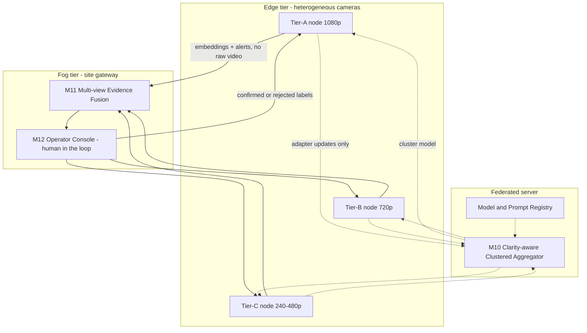
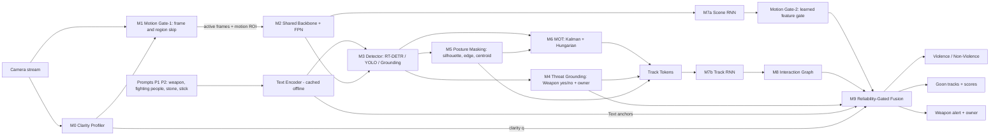
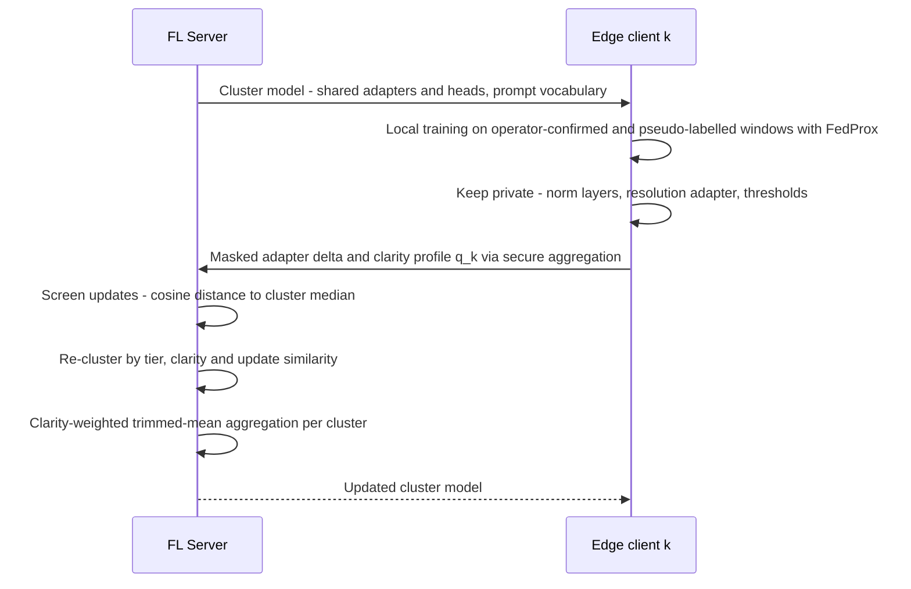

# MOSAIC-FL — Architecture & Ideation Guide
### Violence and Goon Detection in Crowds/Protests under Occlusion, from Heterogeneous Edge Devices, using Federated Learning

> **MOSAIC** = **M**otion-gated · **O**pen-vocabulary · **S**ilhouette-**A**ware · **I**nstigator-**C**entric
> The name is the core metaphor: every edge camera holds a *partial, low-clarity tile* of the scene. No single tile is enough, but together they form the full picture. That's true at inference time (multi-view evidence) and at training time (federated learning).

> [!IMPORTANT]
> This is an **idea/architecture document only**. Nothing here needs implementing yet. The goal is a design that's (1) faithful to the hand-drawn sketch, (2) efficient on low-end edge hardware, (3) original enough to present as a research contribution, and (4) **fully modular**, so any block can be swapped for a better model later.

---

## 0. TL;DR (one-paragraph pitch)

A camera feed first passes through a **cheap motion gate**. Redundant frames (F1 ≈ 95% similar to F2) and static regions are skipped. Surviving frames go through **one shared backbone** (ResNet-family) that feeds four light heads:
- a **swappable person/threat detector** (RT-DETR / YOLO / Grounding)
- an **open-vocabulary "Weapon? Yes/No" grounding** branch driven by text prompts (*"weapon"*, *"fighting people"*)
- a **posture-masking** branch that uses **silhouettes, edges and centroids instead of skeleton joints**
- a **Kalman + Hungarian multi-object tracker** (ByteTrack-class)

Per-person *Track Tokens* are modelled over time by an **RNN** and related to each other by an **interaction graph**, which yields a per-person **instigator ("goon") score**. A **reliability-gated fusion** block combines the scene, weapon, posture, interaction and **text** streams into **Violence / Non-Violence**, plus *who* and *with what*. Training is **federated**, and a single **clarity score** per device conditions three things:
- model tier
- fusion trust
- cluster membership and aggregation weight

---

## 1. Reading the Hand-Drawn Sketch (given highest weight)

Every element of the sketch is kept and turned into a module. Nothing is dropped. Where the sketch is ambiguous, my interpretation is marked ❓ for the team to confirm.

| Sketch element | Interpretation | MOSAIC module |
|---|---|---|
| "Motion Gating" → I/P (left, red) | Compute gate *before* the backbone: skip redundant frames and regions | **M1 – Motion Gate-1** |
| "Video F1 → F2, ~95%" (top-right) | Consecutive frames are ~95% identical, so don't re-process them | **M1** frame-skip criterion |
| "ResNet SOTA" 3-D block, "R,G,B" | Shared CNN backbone on RGB frames, RCNN-style feature maps | **M2 – Shared Backbone + FPN** |
| "RCNN" bracket over backbone | Region features (RoIAlign) pulled per detected person | **M2 → RoI features** for tracks |
| "Grounding" box + "weapons", "fighting people", P1, P2 | Text prompts P1, P2 fed into an open-vocabulary grounding model ❓ | **M4 – Threat Grounding** + prompt bank |
| "Ty" arrow into backbone ❓ | Text-conditioned features (text embeddings injected into the detector) | Text Encoder → M3/M4 |
| "RT-DETR / YOLO / Grounding" with curved swap arrows | **Interchangeable detector heads**, explicitly modular | **M3 – Detector Head (pluggable)** |
| "Weapon? → Yes/No" | Binary weapon evidence feeding fusion | **M4** output |
| "RNN" | Temporal modelling | **M7 – Temporal Encoders** |
| "Motion Gating" after RNN | Second, *learned* gate that modulates features by motion (Flow-Gated idea, without optical flow) | **Motion Gate-2** inside M7 |
| "Posture Masking" | Silhouette/mask-based posture representation | **M5 – Posture Masking** |
| ~~"Joints"~~ (crossed out) | **Skeleton/keypoints rejected** | Deliberately *no* pose estimator in the core path |
| "Detection (Edge & Centroid)" | Contour (edge) and centroid descriptors from masks | **M5** descriptors (SKD) |
| "Bounding Box" | Person boxes | **M3** output |
| "Kalman Filter + Hungarian Matrix → ByteTrack / FastTracker (MOT)" | Multi-object tracking | **M6 – MOT** |
| Big rectangle at bottom | Joint fusion of all streams | **M9 – Reliability-Gated Fusion** |
| "Text → □" into fusion | Text embeddings used as class anchors/context in the final decision ❓ | **M9** text-anchored classifier |
| "Violence / Non-Violence" | Final output | M9 output (+ goon tracks, weapon alerts) |

**Additions not in the sketch, all justified by the problem statement:**
- **M0** clarity profiler (needed for "different resolutions and levels of information clarity")
- **M8** interaction graph (needed for *goon* detection, not just violence)
- **M10** federated aggregator (needed for "using federated learning")
- **M11** multi-view fusion (needed for "multiple edge devices")
- **M12** operator console (this is an HCI project)

---

## 2. Research Problem Clarity *(rubric: 10)*

### 2.1 Formal problem statement

Given **K** heterogeneous edge devices $\{D_k\}$ observing a crowd or protest, where each device has its own resolution $r_k$, frame rate $f_k$, compute budget $c_k$ and information clarity $q_k \in [0,1]$, learn **without centralising raw video** a function that, for every time window $w$, outputs:

1. $y_w \in \{\text{Violent}, \text{Non-violent}\}$ — **scene-level violence**
2. $\{(\text{track}_i, s_i)\}$ — **per-person instigator ("goon") scores**, localised as boxes or masks
3. $\{(\text{object}_j, \text{owner}_i)\}$ — **weapon evidence** and who holds it

This must hold even when **faces are occluded** (masks, helmets, scarves) and **bodies are partially occluded** (dense crowds), and it must run within each device's compute budget.

### 2.2 Core challenges (what makes this hard)

| # | Challenge | Why existing work struggles |
|---|---|---|
| C1 | **Dense crowds and heavy overlap** | NMS suppresses overlapping people, as shown in the provided CrowdDet paper. The tube-based Sensors 2022 method degrades on crowded RLVS for the same reason |
| C2 | **Occluded faces and bodies** | Face-based methods are useless. Skeleton methods lose joints and mis-assign them across overlapping people |
| C3 | **Low and varied resolution and clarity** | Pose estimators collapse when people are only tens of pixels tall. Models trained on HD data don't transfer to 240p CCTV |
| C4 | **Goon ≠ violence** | Most methods classify a *clip*. A protest is mostly peaceful, so we must find *which individuals* are instigating |
| C5 | **Weapons and objects** | Skeleton/pose methods can't see a stone, stick or knife at all |
| C6 | **Privacy and bandwidth** | Raw protest video is sensitive. Centralising it is legally and ethically risky, which motivates FL |
| C7 | **Non-IID, heterogeneous FL clients** | Different cameras see different resolutions, angles and event types. FedAvg drifts, and low-end devices can't train big models |
| C8 | **Weak labels** | Public datasets mostly have *video-level* labels and no per-person "aggressor" boxes |

### 2.3 Why skeleton-based approaches are *not* the core (the "Joints ✗" decision)

The skeleton papers in the list (Pose-to-Protect / OpenPose+LSTM+FL, the DFKI pose-based FL work, CF-STGAT clustered ST-graph FL, FedDet skeleton poisoning, SkeleTR) share these failure modes for *this* problem:

1. **Occlusion breaks the input itself.** Missing or hallucinated joints corrupt the graph, so the model sees a broken skeleton, not a partially visible person.
2. **Crowd joint mis-association.** Bottom-up pose estimators (OpenPose) wire joints across neighbouring people in dense crowds.
3. **Resolution floor.** Keypoints get unreliable when person height is small, which is typical of wide-angle protest CCTV.
4. **Object-blind.** A skeleton can't encode the weapon, the thrown stone, fire or smoke, yet these are often the strongest violence cues.
5. **Unusual fight poses.** Falls, grappling and crouching are out-of-distribution for pose models (the Sensors 2022 paper reports the same issue for person detectors).

**What we keep from them:** the privacy argument (appearance-agnostic representation), the per-person token idea, and the FL insights (clustering, poisoning defence). **What we change:** the representation becomes **silhouette masks + edges + centroid kinematics**, which degrade *gracefully*. Half a mask is still informative; half a skeleton usually isn't.

### 2.4 Research questions

- **RQ1.** Can skeleton-free silhouette-kinematic descriptors match or beat skeletons for violence detection under occlusion and low resolution?
- **RQ2.** Can per-person instigator scores be learned from video-level labels only (weak supervision via MIL)?
- **RQ3.** Does a device *clarity score* used for model tiering, fusion trust and FL clustering improve accuracy and fairness across heterogeneous devices?
- **RQ4.** How much compute does two-stage motion gating save, and at what recall cost?
- **RQ5.** Does a reliability-gated fusion trained with modality dropout let us remove or replace modules with bounded accuracy loss (modularity as a measurable property)?

### 2.5 Scope

- **In scope:** physical violence (fighting, assault, stone-pelting, vandalism with objects), weapon presence, individual instigators, fixed and semi-fixed cameras.
- **Out of scope:** face recognition or identity, verbal or online violence, intent prediction before any physical act.

---

## 3. Dataset / Simulation *(rubric: 10)*

### 3.1 Datasets and their roles

| Dataset | What it gives | Role in MOSAIC |
|---|---|---|
| **RWF-2000** (Cheng et al., ICPR 2020) | 2,000 surveillance clips, video-level fight / non-fight | Primary violence benchmark, clip-level |
| **XD-Violence** (Wu et al., ECCV 2020) | ~4.7k untrimmed videos, weak labels, audio + visual, 6 violence types | Weakly supervised training and evaluation; optional audio plug-in |
| **UCF-Crime** (Sultani et al., CVPR 2018) | 1,900 long untrimmed videos, 13 anomaly classes, weak labels | MIL training; anomaly-style evaluation (AUC) |
| **UCFCrime2Local** | Spatio-temporal boxes for a UCF-Crime subset | **Spatial localisation evaluation** (proxy for goon localisation) |
| **RLVS** (Soliman et al.) | 2,000 clips, includes crowded scenes | Crowd-violence evaluation |
| **Violent-Flows** (Hassner et al.) | Crowd violence clips | **Crowd-specific** evaluation |
| **Hockey Fight** | 1,000 short clips | Sanity check; saturated, so report but don't rely on it |
| **CrowdHuman** | Dense, heavily overlapped person boxes | Train/evaluate the **person detector (M3)** for crowds |
| **MOT20** | Very crowded pedestrian tracking | Evaluate **tracker (M6)** under crowding |
| **Weapon datasets** (e.g., OD-WeaponDetection, knives/pistols) | Weapon boxes | Fine-tune **M4**; evaluate weapon mAP |
| **UCLA Protest Image Dataset** (Won et al., ACM MM 2017) | Protest images with perceived-violence annotations | **Protest-domain** context pretraining and evaluation |
| *Proposed:* **Goon-Annotated Subset** | ~200–300 clips from RWF-2000/RLVS with per-person "aggressor" boxes on keyframes | First benchmark for **instigator localisation** (a small dataset contribution) |

> [!TIP]
> The **Goon-Annotated Subset** is a cheap, high-value contribution. Annotate only keyframes (1 per second) and only "who is aggressing". The tracker propagates the labels across frames.

### 3.2 Labeling strategy (handles C8: weak labels)

1. **Video-level labels**: use as is, through **Multiple Instance Learning**. Clip = bag, person-tracks = instances (idea from Sultani 2018 and the Sensors 2022 tubes, but our instances come from a proper MOT tracker).
2. **Teacher pseudo-labels (server side, public data only)**: run a heavy open-vocabulary teacher (Grounding DINO + SAM-2) over public datasets to auto-generate person masks and weapon boxes, then **distil** into the light edge models.
3. **Operator feedback (deployment)**: confirmations and rejections from the HITL console (M12) become **local labels** for federated fine-tuning.

### 3.3 Simulation of the edge + federated setting

There's no public multi-device protest dataset, so we **simulate heterogeneity reproducibly**:

| Axis | Simulation |
|---|---|
| **Number of clients** | K = 10–20 virtual edge devices |
| **Non-IID data** | Dirichlet partition over datasets/classes (α = 0.1, 0.5, 1.0), plus *dataset-per-client* splits (each client = one "site") |
| **Resolution** | Per-client downscale: 1080p / 720p / 480p / 240p |
| **Clarity** | Gaussian/motion blur, H.264 compression (various CRF), low-light gamma, sensor noise |
| **Frame rate** | 30 / 15 / 5 fps by frame dropping |
| **Occlusion** | Random erasing, crowd copy-paste occluders, **synthetic face occlusion** (masks/helmets/scarves overlay) |
| **Compute tiers** | Tier-A / B / C model widths assigned per client (see §4.6) |
| **Adversaries** | 10–30% clients with label-flipping or backdoor updates, to test robust aggregation |
| **Availability** | Random client dropout per round (20–50%) |

- **Tooling (when implementing later):** Flower (`flwr`) for FL simulation; PyTorch; Ultralytics/RT-DETR repos for detectors; ByteTrack/BoT-SORT reference trackers.
- **Multi-view:** for the multi-view module (M11), simulate "views" by cropping or perspective-warping the same clip at different scales and clarities. Optionally record a small **staged, consented** multi-camera dataset on campus.

### 3.4 Evaluation metrics

| Level | Metrics |
|---|---|
| Clip / scene violence | Accuracy, F1, ROC-AUC (UCF-Crime), AP (XD-Violence) |
| Localisation / goon | Localisation error @IoU 0.5 (UCFCrime2Local), track-level AP for instigators (Goon subset) |
| Weapon | mAP@50, false-positive rate on **protest negatives** (flags, placards, umbrellas) |
| Detection / tracking | AP & MR⁻² on CrowdHuman; HOTA / IDF1 on MOT20 |
| Efficiency | FPS, latency per window, GFLOPs, **% frames gated**, energy (if hardware is available) |
| Federated | Gap to centralised, rounds to converge, bytes/round, **per-tier accuracy (fairness)**, accuracy under attack |
| Modularity | Accuracy drop when a module is removed or swapped (see RQ5) |

---

## 4. Proposed Idea — MOSAIC-FL *(rubric: 15)*

### 4.1 System overview (three tiers)



### 4.2 Edge pipeline (the hand-drawn sketch, formalised)



### 4.3 Module-by-module design

Each module has a fixed **contract** (inputs and outputs). As long as a replacement honours the contract, it can be swapped in without touching the rest of the system.

---

#### M0 — Clarity Profiler *(new; underpins the heterogeneity story)*
- **Purpose:** quantify "levels of information clarity" per device and per window.
- **Signal:** $q = \sigma(\,w_1\cdot\text{res} + w_2\cdot\text{sharpness (Laplacian var.)} + w_3\cdot\text{exposure} + w_4\cdot\text{bitrate} + w_5\cdot\text{median person height}\,)$
- **Output:** scalar $q \in [0,1]$ + device profile {resolution, fps, compute tier}.
- **Used in four places** ("clarity as a first-class signal"):
  1. **Model tier** selection (§4.6)
  2. **Fusion trust** (M9)
  3. **FL clustering and aggregation weight** (M10)
  4. **Multi-view weighting** (M11)
- **Swap options:** hand-crafted formula → learned no-reference IQA model (e.g., BRISQUE-style or a tiny CNN IQA).

#### M1 — Motion Gate-1 (compute gate, before the backbone)
- **Purpose:** the sketch's "F1 ≈ 95% F2". Don't spend compute on unchanged frames or regions.
- **Mechanism:**
  - *Temporal gate:* process a frame only if the change ratio vs. the last processed frame is > τ (e.g., similarity < 95%), with a minimum keep-alive rate (e.g., 2 fps) so slow events aren't missed.
  - *Spatial gate:* a motion mask gives ROIs; the backbone can run on ROI crops or use the mask for early-exit.
  - **Optimistic resume:** when motion spikes, temporarily raise the processing fps (burst mode).
- **Output:** active frame indices, motion mask/ROIs, motion-energy scalar.
- **Default:** frame differencing on downsampled grey frames, or **H.264 motion vectors** (essentially free on edge devices).
- **Swaps:** MOG2 background subtraction · dynamic images (Sensors 2022) · tiny optical flow (e.g., NeuFlow / RAFT-small) on Tier-A only.
- **Unit metric:** violent-frame recall retained (target ≥ 98%) vs. % frames skipped.

#### M2 — Shared Backbone + FPN (the "ResNet SOTA" block)
- **Purpose:** one forward pass and many heads, which is the main efficiency lever.
- **Output:** multi-scale feature maps {P3, P4, P5}; RoIAligned per-person features (the "RCNN" bracket in the sketch).
- **Default:** ResNet-50 (Tier-A), ResNet-18 / MobileNetV4 (Tier-B), MobileNet-class (Tier-C).
- **Swaps:** ConvNeXt-T, EfficientViT, RepViT, or a video backbone (X3D-S / TSM) if temporal context is wanted early.
- **FL note:** backbone weights mostly frozen; **LoRA/adapters + normalisation layers** are the trainable parts (see M10).

#### M3 — Detector Head (pluggable: RT-DETR / YOLO / Grounding)
- **Purpose:** person boxes (and optionally threat-object boxes).
- **Default: RT-DETR.** It's **NMS-free** (one-to-one Hungarian matching), so it avoids the crowd-NMS failure the provided **CrowdDet** paper documents.
- **Swaps:**
  - **YOLO (v8/11, n/s)** for Tier-B/C speed. If used in crowds, add CrowdDet ideas (multi-instance prediction + **Set-NMS**).
  - **Grounding DINO / YOLO-World** for open vocabulary. Grounding DINO is server-side teacher only; YOLO-World or a Grounding-DINO-Edge-class model runs on the edge with **pre-computed (re-parameterised) text embeddings**, so there's no text encoder at runtime.
- **Output contract:** `[box, score, class, feat_id]` per detection.
- **Unit metric:** AP / MR⁻² on CrowdHuman; recall on occluded persons.

#### M4 — Threat Grounding ("Weapon? Yes/No")
- **Purpose:** weapon and object evidence, linked to *who* holds it.
- **Mechanism:**
  1. Open-vocab detection with a **prompt bank**: P1 = "weapon / knife / gun / stick / rod / stone / bottle / fire", P2 = "people fighting / person punching / person throwing".
  2. **Negative prompts** for protest-domain confusers: "flag pole", "placard", "umbrella", "banner stick", "phone". These cut false positives.
  3. **Owner association:** the weapon box is linked to the track whose silhouette mask overlaps or touches it (hand-region proximity), using Hungarian assignment.
- **Output:** `weapon_present ∈ {0,1}`, `p_weapon`, `weapon_box`, `owner_track_id`.
- **Swaps:** a closed-set weapon detector (YOLO fine-tuned on weapon data) if open-vocab is too slow; OWLv2 as an alternative open-vocab model.
- **Design rule:** weapon evidence **alone never triggers "violence"**. It raises suspicion, and posture/motion/interaction must corroborate it.

#### M5 — Posture Masking (replaces skeleton joints)
- **Purpose:** an occlusion-robust, privacy-friendly posture representation.
- **Mechanism (per person box):**
  - **Silhouette mask** (instance segmentation, box-prompted)
  - **Edge map:** mask contour, which carries limb-extension cues (arms raised or swinging)
  - **Centroid** $c_t$ and its kinematics: velocity $\dot c_t$, acceleration $\ddot c_t$, **jerk** (sudden strikes)
  - Shape dynamics: area change, aspect-ratio change, **contour-extremity spread** (how far the silhouette "reaches"), and mask-to-mask **contact/overlap** with neighbours
- **Result:** a compact **Silhouette-Kinematic Descriptor (SKD)** ≈ 32–64 numbers per person per frame.
- **Privacy:** faces inside masks can be **blurred on-device** before anything is stored, which is the second meaning of "posture masking".
- **Default:** segmentation head on the shared backbone (YOLO-seg style; the cheapest option).
- **Swaps:** box-prompted **EdgeSAM / MobileSAM / EfficientSAM** (better masks) · SAM-2 (server-side teacher only) · *fallback:* box-only kinematics (Tier-C).
- **Optional plug-in (not core):** a pose estimator can be added as an *extra* token source when clarity is high. Fusion learns to ignore it when it's unreliable. That's how the skeleton papers become an optional upgrade instead of a dependency.

#### M6 — Multi-Object Tracking (Kalman + Hungarian)
- **Purpose:** stable identities over time, which person-level temporal reasoning needs.
- **Default:** **ByteTrack**. It also associates *low-confidence* boxes, which is exactly what occluded crowd members produce. Kalman filter for motion prediction; Hungarian matching on IoU (+ mask IoU).
- **Swaps:** OC-SORT (non-linear motion, better for erratic fight motion) · BoT-SORT (camera-motion compensation) · a "FastTracker"-class tracker for speed.
- **No appearance Re-ID by default** (privacy, and faces are occluded). Association is motion + mask based.
- **Output:** `track_id` for each detection; track lifecycle events.
- **Unit metric:** IDF1 / HOTA on MOT20.

#### The Track Token (the central interface)
Every person, every processed frame, becomes one standard token. All downstream modules consume **only this**, which is what makes upstream modules swappable.

```yaml
TrackToken:
  track_id: int
  t: timestamp
  box: [x1, y1, x2, y2]          # from M3
  mask_rle: bytes                 # from M5 (optional field)
  skd: float[48]                  # silhouette-kinematic descriptor (M5)
  centroid: [cx, cy]; vel: [vx, vy]; acc: [ax, ay]
  roi_feat: float[256]            # RoIAlign from M2 (the "RCNN" part)
  weapon_prob: float              # from M4 (0 if none associated)
  det_conf: float                 # detector confidence
  occlusion_ratio: float          # visible-mask / box area
  clarity_q: float                # from M0
```

#### M7 — Temporal Encoders (the "RNN")
- **M7a – Scene stream:** pooled backbone features of active frames go into a **ConvGRU/GRU**, giving a scene embedding $h^{scene}$.
  - **Motion Gate-2 (learned):** $\tilde h = h^{scene} \odot \sigma(W\,m)$, where $m$ is the motion energy from M1. This is the sketch's "Motion Gating" after the RNN. It's the Flow-Gated Network idea from the RWF-2000 paper, but driven by *cheap* motion instead of expensive optical flow.
- **M7b – Track stream:** each track's token sequence goes into a **GRU** (shared weights), giving a per-person embedding $h_i$ and an instance score $s_i$.
- **Swaps:** TCN (parallel, fast) · Temporal Shift Module · small Transformer · Mamba-style state-space model (long windows, linear cost).

#### M8 — Interaction Graph (goon / instigator reasoning)
- **Purpose:** violence is *relational*. A goon is defined by what they do *to others*.
- **Graph:** nodes = tracks ($h_i$). Edges are weighted by proximity, **relative approach velocity** (who moves toward whom), mask contact, and weapon ownership.
- **Model:** Actor-Transformer-style self-attention over track embeddings with a spatial-distance bias (from the Actor-Transformers reference, but fed **silhouette tokens instead of pose**). Alternative: a 2-layer GAT.
- **Outputs:**
  - Per-person **instigator score** $g_i$: high if the person approaches fast, makes contact, has a weapon, or is attended to by many "victim-like" nodes
  - A **crowd-level** embedding $h^{crowd}$ (e.g., sudden dispersal and radial flight patterns, typical of panic after violence)
- **Swaps:** a simple rule-based "approach + contact + jerk" scorer (baseline / Tier-C) · ST-graph networks.

#### M9 — Reliability-Gated Fusion (the big box) + Text
- **Inputs (tokens):** $\tilde h^{scene}$, $h^{crowd}$, top-k $h_i$ (by instance score), weapon token, **text anchor tokens**, and the clarity $q$.
- **Mechanism:**
  1. Each token gets a **reliability weight** $\rho = f(q, \text{det\_conf}, \text{occlusion\_ratio})$ that scales its attention logits. Low-clarity or heavily occluded evidence counts less.
  2. A 2-layer cross-attention Transformer with a `[CLS]` token.
  3. **Text-anchored classifier:** the score is the cosine similarity between `[CLS]` and CLIP text embeddings of class descriptions ("a violent fight in a crowd", "people throwing stones", "a peaceful protest march", …). New behaviour classes can be added *by adding text*, without retraining the head (the sketch's "Text → □").
  4. **Modality dropout** in training (each stream randomly dropped with p ≈ 0.2–0.3). This is what makes the system **modular**: if a module is missing, swapped or failing, the fusion still works.
- **Outputs:** $P(\text{violence})$; goon list $\{(i, g_i)\}$ above threshold; weapon alert with owner; attention-based **explanation** (which tokens drove the decision), shown to the operator.

#### M10 — Clarity-Aware Clustered Federated Learning (server)
| Parameter group | Treatment | Why |
|---|---|---|
| Backbone core, text encoder, detector core | **Frozen** (pretrained) | Too big for edge training; stable |
| LoRA adapters in backbone, M7, M8, M9 | **Federated (shared within cluster)** | Small payload, collaborative learning |
| BatchNorm/LayerNorm stats, resolution adapter, decision thresholds | **Private (local)** | Resolution/clarity-specific statistics (FedBN idea; also the public/private split from the personalised-FL reference) |

- **Clustering:** clients are grouped by (device tier, clarity profile, update similarity). Each cluster gets its own head, so a 240p cluster isn't dragged toward 1080p behaviour (the CF-STGAT idea, applied to *non-skeleton* models).
- **Local optimiser:** FedProx (proximal term against drift).
- **Aggregation:** $w_k = \dfrac{n_k\, q_k^{\gamma}}{\sum_j n_j\, q_j^{\gamma}}$, applied within each cluster, followed by a **coordinate-wise trimmed mean**.
- **Poisoning defence (generalises FedDet beyond skeletons):** screen each update by cosine distance to the cluster median; flag outliers; optionally use FLTrust with a small server-side clean root set.
- **Heterogeneous compute:** Tier-C trains a **width-sliced sub-model** (HeteroFL idea), or only the heads.
- **Privacy:** secure aggregation; optional DP-SGD; faces blurred on-device; **no raw frames ever leave the edge**.



#### M11 — Multi-View Evidence Fusion (fog, optional)
- Cameras covering the same zone send **compact embeddings + scores** per window (not video).
- Fusion: clarity-weighted attention over views, so a view where the person is occluded defers to a clearer view.
- Swaps: simple max/mean of scores (baseline) · Dempster–Shafer evidence combination · learned cross-view attention.

#### M12 — Operator Console (HITL; the HCI contribution)
- Ranked alerts with **why** (top contributing tokens, weapon crop, goon track highlight with silhouettes, not faces).
- One-click **confirm / reject / relabel**. These become local labels for the next FL round, closing the loop.
- Alert-fatigue controls: per-zone thresholds, alert grouping, escalation levels (Suspicious → Weapon seen → Violence).

### 4.4 Training strategy (stages)

| Stage | Where | What |
|---|---|---|
| S1 | Server, public data | Pretrain/borrow backbone (ImageNet/COCO), detector (CrowdHuman + COCO-person + weapon data) |
| S2 | Server, public data | Teacher pseudo-labels: Grounding DINO + SAM-2 produce masks and weapon boxes on violence datasets |
| S3 | Server, public data | Warm-start M7–M9 with **MIL**: top-k track scores → clip score; BCE + Sultani-style ranking, smoothness and sparsity losses; **modality dropout** |
| S4 | Simulated edge clients | **Federated fine-tuning** (M10) under heterogeneity simulation (§3.3) |
| S5 | Deployment | **Personalisation + HITL feedback**, continual federated rounds |

**Loss (per window):**
$\mathcal L = \mathcal L_{\text{MIL-clip}} + \lambda_1 \mathcal L_{\text{rank}} + \lambda_2 \mathcal L_{\text{smooth}} + \lambda_3 \mathcal L_{\text{sparse}} + \lambda_4 \mathcal L_{\text{text-align}} + \lambda_5 \mathcal L_{\text{distill}} \; [+\, \mathcal L_{\text{goon}} \text{ on the annotated subset}]$

### 4.5 Inference flow (one window ≈ 2 s)

1. M0 updates $q$; M1 keeps the active frames (e.g., 4–16 of 60).
2. M2 → M3/M4/M5 on the active frames only; M6 tracks across *all* frames (Kalman prediction fills the skipped ones).
3. Build Track Tokens → M7b → M8; the scene stream runs M7a + Gate-2 in parallel.
4. M9 produces the decision + goon list + weapon owner → sent to M11/M12 as embeddings + alert.
5. **Early exit:** if Gate-1 sees no motion *and* the scene score stays low, skip M5/M8 entirely (Tier-C saves most here).

### 4.6 Device tiers (same architecture, different module choices)

| | Tier-A (e.g., Jetson Orin NX, 1080p) | Tier-B (e.g., Orin Nano / Pi 5 + NPU, 720p) | Tier-C (low-end, 240–480p) |
|---|---|---|---|
| M1 | Motion vectors + tiny flow | Motion vectors | Frame diff |
| M2 | ResNet-50 / ConvNeXt-T | ResNet-18 / MobileNetV4 | MobileNet-class |
| M3 | RT-DETR | RT-DETR-small / YOLO-s | YOLO-n |
| M4 | Open-vocab (cached text) | Open-vocab (small vocabulary) | Closed-set weapon head or **offload** |
| M5 | Box-prompted EdgeSAM | Seg head | Box-only kinematics |
| M7 | Small Transformer / GRU | GRU | GRU (tiny) |
| M8 | Actor-Transformer | 1-layer GAT | Rule-based scorer |
| FL role | Full adapters | Adapters | Heads only / width-sliced |

> [!NOTE]
> Latency figures should be **profiled**, not assumed. The design target is **≥ 10 processed fps on Tier-B after gating** and a **≤ 1 s alert latency** per window. Treat these as goals to verify.

### 4.7 What is novel (contribution list for the paper)

1. **Dual Motion Gating:** a *compute* gate before the backbone (frame + region skip) **and** a *learned* feature gate after the RNN, both driven by the same cheap motion signal. No optical flow required.
2. **Skeleton-free Silhouette-Kinematic Descriptors (SKD):** masks + edges + centroid kinematics as an occlusion- and resolution-robust replacement for joints.
3. **Open-vocabulary threat grounding with owner association and protest-aware negative prompts.**
4. **Instigator-centric weak supervision:** per-person goon scores from video-level labels via track-level MIL + interaction graph.
5. **Clarity as a first-class signal:** one score reused for model tiering, fusion trust, FL clustering/aggregation and multi-view weighting.
6. **Modularity by construction:** standard Track Token contract + modality-dropout fusion, with "swap cost" measured as an experimental quantity.
7. **Human-in-the-loop federated feedback:** operator confirmations become federated training signal (the HCI angle).

---

## 5. Comparison with SOTA & Expected Results *(rubric: 15)*

### 5.1 Capability matrix

✓ = addressed · ◐ = partial · ✗ = not addressed

| Method | Crowd/occlusion robust | Per-person localisation (goon) | Weapon aware | Federated | Heterogeneous devices | Privacy-preserving rep. | Edge-efficient | Open-vocab / extensible |
|---|---|---|---|---|---|---|---|---|
| Flow-Gated Net (RWF-2000, 2020) | ✗ | ✗ | ✗ | ✗ | ✗ | ✗ | ◐ | ✗ |
| Sultani MIL (2018) | ✗ | ✗ (temporal only) | ✗ | ✗ | ✗ | ✗ | ◐ | ✗ |
| XD-Violence HL-Net (2020) | ✗ | ✗ | ✗ | ✗ | ✗ | ✗ | ◐ | ✗ |
| Choqueluque-Roman (Sensors 2022) | ◐ (fails in crowds) | ✓ (tubes) | ✗ | ✗ | ✗ | ✗ | ◐ | ✗ |
| Actor-Transformers (2020) | ◐ (pose-dependent) | ✓ | ✗ | ✗ | ✗ | ✗ | ✗ | ✗ |
| SkeleTR (2023) | ◐ (pose-dependent) | ✓ | ✗ | ✗ | ✗ | ✓ | ◐ | ✗ |
| Pose-to-Protect (FL + skeleton, 2025) | ✗ | ✗ | ✗ | ✓ | ✗ | ✓ | ✓ | ✗ |
| CF-STGAT (clustered FL skeleton) | ✗ | ✗ | ✗ | ✓ (clustered) | ◐ | ✓ | ◐ | ✗ |
| FedDet (FL skeleton poisoning) | ✗ | ✗ | ✗ | ✓ (robust) | ✗ | ✓ | ◐ | ✗ |
| Personalised FL video AR (CMC 2025) | ✗ | ✗ | ✗ | ✓ (personalised) | ◐ | ◐ | ◐ | ✗ |
| FedFSLAR (2024) | ✗ | ✗ | ✗ | ✓ | ✗ | ◐ | ✗ | ◐ (few-shot) |
| **MOSAIC-FL (proposed)** | **✓** | **✓** | **✓** | **✓ (clustered + robust + personalised)** | **✓ (clarity-aware)** | **✓ (silhouettes, no raw video)** | **✓ (dual gating, tiers)** | **✓ (text prompts)** |

### 5.2 Reported reference numbers (baselines to beat)

> [!WARNING]
> These figures come from the papers themselves (the provided PDFs and well-known results). **Re-verify every number against the original paper before it goes into your report.**

| Benchmark | Method | Reported |
|---|---|---|
| RWF-2000 (Acc.) | Flow-Gated Network | 87.25% |
| RWF-2000 (Acc.) | Choqueluque-Roman (tubes + MIL) | 88.71% |
| RWF-2000 (Acc.) | SepConvLSTM (Islam et al.) | 89.75% |
| UCF-Crime (AUC) | Sultani MIL | 75.41% |
| UCF-Crime (AUC) | RTFM | 84.30% |
| UCF-Crime (AUC) | VadCLIP (CLIP-based) | 88.02% |
| XD-Violence (AP) | Wu et al. HL-Net (audio + visual) | 78.64% |
| XD-Violence (AP) | VadCLIP | 84.51% |
| UCFCrime2Local (Loc. error ↓) | Choqueluque-Roman 2022 | 31.92% |
| CrowdHuman (AP) | FPN → CrowdDet (EMD + Set-NMS) | 85.8% → 90.7% |
| UCF-101 non-IID FL (Acc.) | Personalised FL video AR | 97.79% (generic actions, not violence) |

### 5.3 Expected results (stated as testable hypotheses with targets)

| ID | Hypothesis | Target (to verify) |
|---|---|---|
| H1 | Centralised MOSAIC is competitive on standard clip benchmarks | RWF-2000 ≥ 90% Acc.; UCF-Crime ≥ 85% AUC; XD-Violence (visual-only) ≥ 80% AP |
| H2 | Federated training stays close to centralised | ≤ 3% absolute gap under Dirichlet α = 0.5 |
| H3 | Clarity-aware clustering improves *low-tier fairness* | Tier-C accuracy +3–5% vs. FedAvg; smaller best-vs-worst tier gap |
| H4 | SKD beats skeletons under occlusion and low resolution | At 240p + 30% occlusion, accuracy drop ≤ ½ of the OpenPose+LSTM baseline's drop |
| H5 | Better localisation than tube-based SOTA | UCFCrime2Local localisation error < 31.92% (target ≤ 28%) |
| H6 | Dual gating saves compute with negligible recall loss | ≥ 40% frames skipped on mostly-static footage with ≥ 98% violent-frame recall |
| H7 | Weapon negatives reduce protest false alarms | Lower weapon-FP rate on flags/placards/umbrellas vs. no negative prompts |
| H8 | Modality-dropout fusion makes modules swappable | Removing any single stream costs ≤ 5% Acc.; swapping a detector needs no fusion retraining |
| H9 | Robust aggregation resists poisoning | With 20% malicious clients, accuracy drop ≤ 3% (vs. large drop under FedAvg) |

### 5.4 Ablation plan (what proves each claim)

1. **Representation:** RGB-only vs. + skeleton vs. **+ SKD** vs. + both. Evaluate under clean / low-res / occluded conditions.
2. **Gating:** none vs. Gate-1 vs. Gate-2 vs. both. Report accuracy, FPS and % skipped.
3. **Detector swap:** RT-DETR vs. YOLO vs. YOLO + Set-NMS. Report crowd recall and downstream accuracy.
4. **Tracker swap:** IoU-linking (Sensors 2022 style) vs. ByteTrack vs. OC-SORT.
5. **Goon reasoning:** no graph vs. rule-based vs. Actor-Transformer.
6. **Fusion:** concat vs. CFAM (Sensors 2022) vs. **reliability-gated + modality dropout**.
7. **FL:** FedAvg vs. FedProx vs. FedBN vs. clustered vs. **clarity-aware clustered**; with and without trimmed mean under attack.
8. **Text anchors:** linear head vs. text-anchored head (incl. zero-shot new class).

### 5.5 Risks and mitigations

| Risk | Mitigation |
|---|---|
| Protest props (sticks, flags) cause weapon false positives | Negative prompts; weapon alone never triggers violence; owner + motion corroboration |
| Masks merge in extreme density | RT-DETR boxes + mask IoU in tracking; fall back to centroid kinematics; multi-view (M11) |
| Domain gap (datasets ≠ protests) | UCLA Protest images, synthetic occlusion/face-masking, HITL personalisation |
| Weak labels make goon scores noisy | Small Goon-Annotated Subset for validation; top-k MIL; temporal smoothness |
| Low-tier devices can't train | Heads-only / width-sliced training; offload uncertain windows to fog |
| Ethical misuse (profiling protesters) | No face recognition or identity; silhouettes only; human confirmation required; audit logs; data retention limits |

---

## 6. Modularity Playbook (how to replace a module that underperforms)

### 6.1 Rules
1. **Contracts, not code:** each module declares its I/O (as in §4.3). The **Track Token** is the hub interface.
2. **Registry + config:** each module is selected by name in a config file (e.g., `detector: rtdetr_r18`). Swapping is a config change.
3. **Unit metric per module:** each module is judged on its *own* metric first, then on end-to-end impact.
4. **Fusion is robust to absence:** modality dropout means a temporarily removed module degrades gracefully.

### 6.2 Swap table

| Module | Default | Lighter | Stronger | Replace when… |
|---|---|---|---|---|
| M0 Clarity | Hand-crafted formula | — | Learned NR-IQA | $q$ correlates poorly with per-device accuracy |
| M1 Gate | Motion vectors / frame diff | Frame diff @ low res | Tiny optical flow | Violent-frame recall < 98% |
| M2 Backbone | ResNet-50 / 18 | MobileNetV4 | ConvNeXt-T / EfficientViT | Detector AP or FPS off target |
| M3 Detector | RT-DETR | YOLO-n/s (+ Set-NMS) | Larger RT-DETR / DINO-class | CrowdHuman MR⁻² high; missed occluded persons |
| M4 Grounding | YOLO-World-class (cached text) | Closed-set weapon head | Grounding DINO (server) | Weapon mAP low or FP on props high |
| M5 Posture | Seg head | Box-only kinematics | EdgeSAM / MobileSAM | Mask quality (mIoU) low on occluded people |
| M6 Tracker | ByteTrack | SORT | OC-SORT / BoT-SORT | IDF1 drops in crowds; ID switches during fights |
| M7 Temporal | GRU | TCN | Transformer / Mamba | Long-range events missed |
| M8 Graph | Actor-Transformer | Rule-based | ST-graph network | Goon AP low on annotated subset |
| M9 Fusion | Reliability-gated Transformer | Weighted late fusion | Larger cross-modal Transformer | Calibration poor; one stream dominates |
| M10 FL | Clarity-aware clustered FedProx | FedAvg + FedBN | Ditto / FedRep / SCAFFOLD | Tier gap large; divergence across rounds |
| Optional plug-ins | — | — | Audio (XD-Violence-style), pose tokens | When hardware or clarity allow |

---

## 7. Roadmap (idea → future implementation)

| Phase | Goal | Exit criterion |
|---|---|---|
| P0 | Finalise problem, datasets, metrics (this document) | Team sign-off on sketch interpretation |
| P1 | Centralised baseline: M1–M3, M6, M7a, simple fusion on RWF-2000 | Reproduce ~87–89% Acc. |
| P2 | Add M5 (SKD), M4 (weapon), M8 (graph), M9 (full fusion) | H1, H4, H5 trends visible |
| P3 | Federated simulation with heterogeneity (Flower) | H2, H3, H9 |
| P4 | Edge profiling, tiers, gating | H6 on real or emulated hardware |
| P5 | HITL console + feedback loop; Goon subset release | Usability study (HCI evaluation) |

---

## 8. Open Questions for the Team

1. **Sketch ambiguities:** are **P1/P2** the text prompts ("weapons", "fighting people")? What do **"Ty"** and **"Fles"** next to Grounding mean? Is the **"Text →"** input into the fusion meant as class prompts or as scene metadata?
2. **Audio:** can we use microphones (XD-Violence shows audio helps), or is it visual-only?
3. **Hardware:** which edge devices can we access, if any (Jetson / Raspberry Pi / phones)? This decides the tiers.
4. **Multi-view at inference (M11):** in scope for this phase, or future work?
5. **Goon annotation:** can the team spend a few hours annotating the ~200–300-clip instigator subset?

---

## References (from the provided list + supporting)

1. Tu et al., *FedFSLAR: A Federated Learning Framework for Few-Shot Action Recognition*, WACV-W 2024.
2. Wu et al., *Video Action Recognition Based on Personalized Federated Learning and Spatiotemporal Features*, CMC 83(3), 2025.
3. DFKI — Federated pose-based action recognition.
4. Clustered federated spatio-temporal graph action recognition (CF-STGAT), 2025.
5. Famouri, Hossain, Imteaj, *Pose to Protect: Federated Skeleton-Based Anomaly Detection for Privacy-Conscious Video Surveillance*, ICCV-W 2025.
6. Kim et al., *FedDet: Data Poisoning Attack Detection for Federated Skeleton-based Action Recognition*, Information Sciences, 2025.
7. Cheng, Cai, Li, *RWF-2000: An Open Large Scale Video Database for Violence Detection*, ICPR 2020.
8. Sultani, Chen, Shah, *Real-World Anomaly Detection in Surveillance Videos*, CVPR 2018.
9. Wu et al., *Not only Look, but also Listen: Learning Multimodal Violence Detection under Weak Supervision* (XD-Violence), ECCV 2020.
10. Gavrilyuk et al., *Actor-Transformers for Group Activity Recognition*, CVPR 2020.
11. Duan et al., *SkeleTR: Towards Skeleton-based Action Recognition in the Wild*, ICCV 2023.
12. Chu et al., *Detection in Crowded Scenes: One Proposal, Multiple Predictions* (CrowdDet), CVPR 2020 — *provided PDF*.
13. Choqueluque-Roman & Cámara-Chávez, *Weakly Supervised Violence Detection in Surveillance Video*, Sensors 22(12):4502, 2022 — *provided PDF*.
14. Supporting: RT-DETR (Zhao et al., CVPR 2024); ByteTrack (Zhang et al., ECCV 2022); Grounding DINO (Liu et al., 2023); YOLO-World (Cheng et al., CVPR 2024); SAM-2 (Ravi et al., 2024); FedProx (Li et al., 2020); FedBN (Li et al., ICLR 2021); HeteroFL (Diao et al., ICLR 2021); FLTrust (Cao et al., NDSS 2021); RTFM (Tian et al., ICCV 2021); VadCLIP (Wu et al., AAAI 2024); Won et al., Protest Activity Detection (ACM MM 2017).
