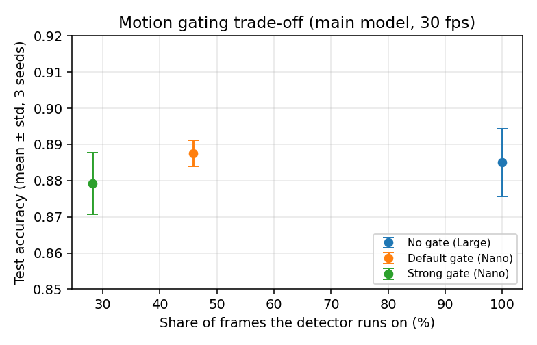

# RWF-2000 results

Official test set (400 clips). Data: the 30 fps copy (150 frames per clip, 64 sampled, 7 windows). Every number is the mean ± std over
3 seeds (42, 1337, 2024); F1, AUC and ECE are means; flip test-time averaging is on. The model is selected on an internal
validation split grouped by source video, and the test set is used only for the final score.

**Main model:** no interaction graph (GAT), mask features on, person branch = per-person GRU + attention pooling, fused with
frozen Video Swin-T scene features. Default pipeline: motion gate (always on) -> RF-DETR-Seg Nano -> ByteTrack.

## T1  Main model

| Setting | Val acc | Test acc | F1 | AUC | ECE |
|---|---|---|---|---|---|
| **Nano, default gate (46% of frames): current pipeline** | 0.894 ± 0.007 | 0.888 ± 0.004 | 0.882 | 0.958 | 0.086 |
| Nano, strong gate (28%) | 0.892 ± 0.005 | 0.879 ± 0.008 | 0.874 | 0.950 | 0.092 |
| Large, no gate | 0.898 ± 0.005 | 0.885 ± 0.009 | 0.881 | 0.959 | 0.089 |

## T2  Ablations, Nano + default gate

| Variant | Val acc | Test acc | F1 | AUC | ECE |
|---|---|---|---|---|---|
| **No GAT, masks on (MAIN)** | 0.894 ± 0.007 | 0.888 ± 0.004 | 0.882 | 0.958 | 0.086 |
| + GAT and stronger regularization | 0.886 ± 0.009 | 0.886 ± 0.002 | 0.879 | 0.951 | 0.088 |
| Box-only (mask features off), with GAT | 0.900 ± 0.007 | 0.879 ± 0.003 | 0.875 | 0.943 | 0.103 |

## T3  Ablations, Large detector, no gate

| Variant | Val acc | Test acc | F1 | AUC | ECE |
|---|---|---|---|---|---|
| **No GAT, masks on (MAIN)** | 0.898 ± 0.005 | 0.885 ± 0.009 | 0.881 | 0.959 | 0.089 |
| + GAT and stronger regularization | 0.894 ± 0.003 | 0.888 ± 0.005 | 0.885 | 0.962 | 0.077 |
| Box-only (mask features off), with GAT | 0.892 ± 0.008 | 0.887 ± 0.006 | 0.882 | 0.956 | 0.089 |
| Scene only | 0.892 ± 0.009 | 0.872 ± 0.005 | 0.867 | 0.940 | 0.093 |
| Scene only + regularization | 0.877 ± 0.005 | 0.860 ± 0.011 | 0.853 | 0.943 | 0.082 |
| People only | 0.890 ± 0.012 | 0.864 ± 0.006 | 0.858 | 0.939 | 0.097 |

## T6  Gating trade-off (main model)

| Setting | Frames detected | Test acc | AUC | People per window | Windows with 1+ person |
|---|---|---|---|---|---|
| No gate (Large) | 100% | 0.885 ± 0.009 | 0.959 | 4.29 | 92% |
| Default gate (Nano) | 46% | 0.888 ± 0.004 | 0.958 | 3.05 | 57% |
| Strong gate (Nano) | 28% | 0.879 ± 0.008 | 0.950 | 2.04 | 37% |

## T7  Scene-only reference

| Probe on frozen Swin-T features (scene only) | Test acc | AUC |
|---|---|---|
| Logistic regression on the window average | 0.858 | 0.942 |
| Linear head, top-3 window pooling | 0.885 | 0.954 |

## Reading the tables

- The ablations are **within seed noise of each other**: GAT, no GAT, box-only and the full model all land between about 0.88 and 0.89.
  The GAT never helped, so the main model omits it. Masks did not help either (box-only matches); they are kept for now.
- At 30 fps the **scene-only linear probe (0.885) matches the main model**, so the person branch is not clearly ahead of a good scene baseline.
- The **default gate** detects about half the frames at no measurable accuracy cost; the strong gate costs about 1 point.
- Published results are about 94-95% ([CUE-Net, CVPRW 2024](https://arxiv.org/pdf/2404.18952): 94.00%; a
  [Nov 2025 preprint](https://arxiv.org/pdf/2511.10866): 95.25%), so this work is not at the state of the art yet.

## Spatio-temporal outputs

On 50 test fight clips the model called 45 violent. The violent intervals cover on average 78% of the clip (median 87%); 18 intervals cover the whole clip and 3 clips have two or more separate intervals. These describe the outputs; they are **not scored** against ground truth (RWF-2000 has no time or box labels).

The demo videos in `outputs/demo/` and the statistics above come from the **GAT model (R1, seed 42) on Large detections with no gate**,
not from the main model: only that checkpoint was saved. Red box = the model's attention-weighted focus area, not a judgment of
individuals. `figures/mask_examples.jpg` shows RF-DETR-Seg **Large** masks on four clips.

## Files

`tables/all_results.csv` (every run), `runs/<setting>/<variant>_s<seed>.json` (full metrics and training history),
`splits/rwf2000_30fps_split.csv` (fit / internal_val / test per clip), `figures/`, `outputs/`.
Regenerate with `python scripts/make_results.py --dataset rwf2000`.
